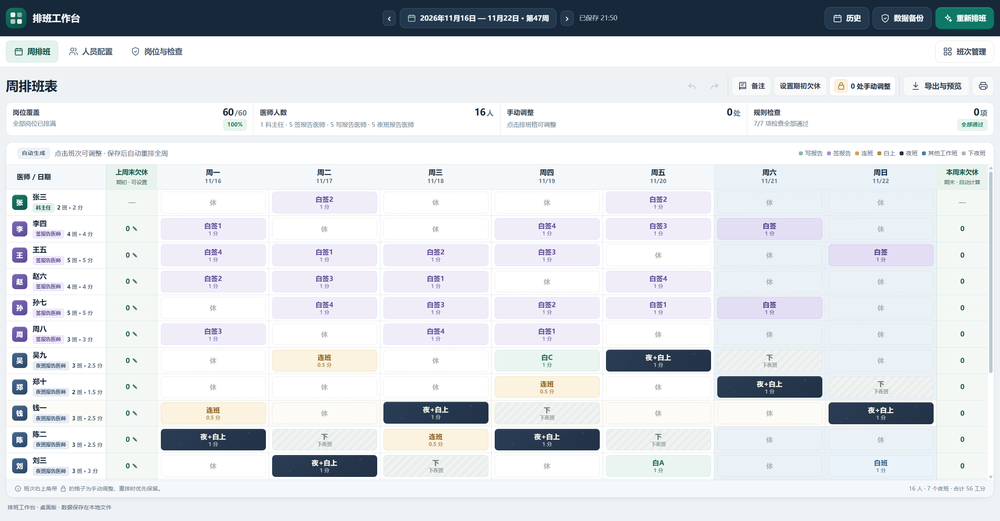
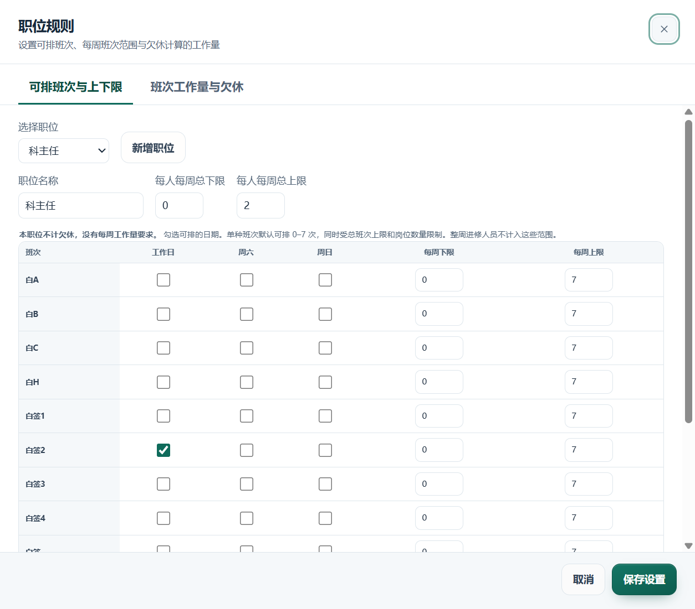
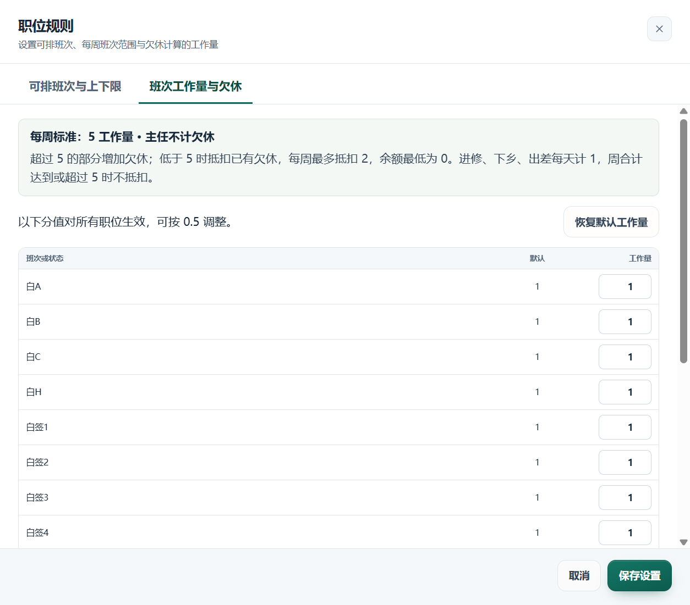
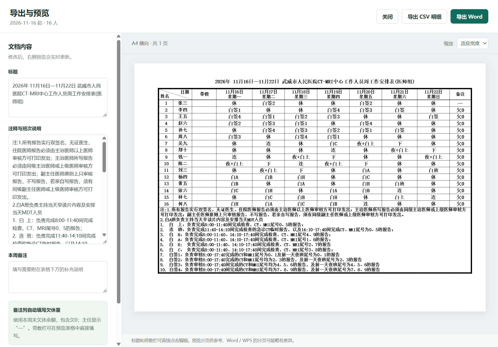

# 排班工作台完整使用手册

Windows 桌面版 v4.6.0　　更新日期 2026年11月18日

本手册说明软件从首次解压、配置人员到生成班表、核算欠休、导出发布和备份迁移的完整流程。软件适用于 Windows 10/11 64 位，日常运行不需要联网，也不需要安装 Node.js 或 Python。

建议先按下面的流程完成一次排班，再按目录查阅具体功能。图示使用张三、李四等虚构示例姓名，周次和排班安排仅用于说明操作，不代表真实人员或排班。

## 第一次排班按此顺序操作

1. 将压缩包完整解压到可写目录，打开解压后的“排班工作台”文件夹，双击“排班工作台.exe”。不要直接在压缩包内运行。
2. 核对顶部周次。在“人员配置”确认姓名、职位和整周进修状态。
3. 在“职位规则”和“岗位与检查”核对可排班次、上下限及岗位人数。
4. 返回“周排班”，点击“设置期初欠休”，录入首次使用时的余额；已有连续历史的人员可自动结转。
5. 点击“智能排班”或“重新排班”。等到岗位覆盖完整、规则检查通过后，再进行手动微调。
6. 点击需要调整的排班格，选择班次或状态，点击“保存并重排”，再核对其他人的变化。
7. 点击“导出与预览”，修改标题、注释和本周备注，填写带教，核对备注列欠休量后导出 Word。
8. 确认顶部显示“已保存”，再通过“数据备份”保存完整 JSON 备份。需要纸质表时，在 Word/WPS 中核对后打印。

## 按任务查找

| 任务 | 手册章节 |
| --- | --- |
| 启动与认识界面 | 1 |
| 人员名单与名单方案 | 2 |
| 职位规则与班次岗位 | 3、4 |
| 自动排班与手动调整 | 5 |
| 历史记录与跨周衔接 | 6 |
| 工作量与欠休计算 | 7 |
| 导出预览与打印 | 8、9 |
| 备份恢复与迁移 | 10、11 |
| 常见问题与发布前检查 | 12 |

<!-- page -->
# 1 启动与认识界面

## 解压和启动

将压缩包解压后，进入“排班工作台”文件夹，双击“排班工作台.exe”。请保留同级的 resources、locales、配套 DLL 和 data 文件夹，单独复制 EXE 无法正常运行。项目工作目录中的“启动排班软件.bat”也可启动软件，但免安装包内直接打开 EXE 即可。

软件数据默认写入 EXE 同级的 data 文件夹，data.json 保存工作区和历史等数据，data.json.bak 是上一次完整写入的副本。可使用普通工作文件夹或移动硬盘上的可写目录；如果目录只读，界面会提示无法保存。点击“数据备份—打开数据文件夹”可查看实际位置。

## 主要入口

| 入口 | 用途 |
| --- | --- |
| 顶部左右箭头与周次 | 切换到上一周或下一周，确认当前编辑的日期 |
| 周排班 | 查看班表、设置期初欠休、手动调班、填写备注、导出与打印 |
| 人员配置 | 添加或修改医师、调整职位、设置整周进修、管理名单方案 |
| 岗位与检查 | 核对岗位人数、覆盖明细和规则问题 |
| 班次管理 | 新增、改名或删除班次 |
| 历史 | 保存本周、读取或删除历史、导入旧 CSV |
| 数据备份 | 导出完整备份、恢复数据、查看实际数据目录 |

“已保存”表示当前内容已写入本机。岗位覆盖完整不等于所有规则均通过，还需要核对“规则检查”。更换周次或读取历史后，应再次确认顶部日期。

<!-- page -->
# 2 配置人员与名单方案

## 添加和修改人员

进入“人员配置”，点击“添加”，填写姓名并选择职位。已有医师可以直接修改姓名、切换职位；整周不参与排班时，可使用人员行中的进修状态。仅某一天进修、下乡、休假或出差，应在该日排班格中设置状态。

人员变动会触发重新检查或重排，其他人员的班次可能随之变化。人数暂时不足时，名单修改仍会保存，可以继续补充人员、调整职位或岗位后再生成，不必为了凑齐班表而撤销正确的人员变动。

## 职位如何选择

内置职位为科主任、签报告医师、写报告医师、夜班报告医师。默认写报告医师不排夜班，夜班报告医师可排写报告岗位和夜班；签报告医师承担相应审核岗位。实际资格以“职位规则”中的当前配置为准，不仅取决于职位名称。

整周进修人员不承担实际岗位，免除每周班次下限。进修仍按当前欠休规则计入出勤工作量，不能据此理解为工作量为零。

## 保存和载入名单方案

1. 点击“名单方案”，输入方案名并保存当前名单。相同名称再次保存会更新原方案。
2. 需要换用另一套人员时，选择方案并点击“载入”，核对确认提示。
3. 载入会替换当前人员名单，清空当前排班和手动锁定；随后点击“智能排班”或“重新排班”生成。

名单方案保存人员及职位配置，不是完整班表或全量备份。删除某个方案不影响正在使用的名单。“恢复科室名单”会载入软件内置的16人名单并尝试重新生成，不用于恢复个人之前的名单；应优先使用自己的方案或完整备份。

<!-- page -->
# 3 设置职位规则

在“人员配置”点击“职位规则”，打开独立设置窗口。“可排班次与上下限”用于管理职位资格，“班次工作量与欠休”用于设置分值。

## 设置顺序

1. 选择已有职位，或新增、改名一个职位。
2. 分别勾选该职位在工作日、周六和周日可以承担的班次。
3. 设置每人每周实际班次的总下限和总上限。
4. 如需限制某一班次的次数，再设置该班次的单独上下限。
5. 点击“保存设置”，返回主界面核对规则检查；必要时重新生成班表。

总班次与单班次范围须满足“0 ≤ 下限 ≤ 上限 ≤ 7”。所有单班次下限之和不能超过总上限，某班次下限也不能超过允许排它的天数。范围按该职位的每名人员分别生效，不是整个职位合计。

## 默认资格和上限

| 职位 | 默认范围概要 |
| --- | --- |
| 科主任 | 仅工作日白班、白签2；每周合计最多2班；不计欠休 |
| 签报告医师 | 工作日白签1至4，周末白签；最多5个实际班 |
| 写报告医师 | 工作日白A/B/C/H、连班；周末按日期允许白班、白上、连班；最多5班 |
| 夜班报告医师 | 写报告岗位加夜+白上；最多5个实际班 |

默认规则可以调整。改名不会把一个普通班次变成夜班；原有夜班改名后仍保留“次日下夜班”的衔接属性。规则冲突时，可先保存设置，再补足人员、调整资格或岗位数量后生成。

<!-- page -->
# 4 管理班次和岗位人数

## 班次名称与岗位数量是两项设置

“班次管理”定义有哪些班次；“岗位数量”定义每个日期类别需要多少人。新增一个班次不会自动增加岗位，也不会自动允许所有职位承担。

1. 点击“班次管理”，新增班次或直接修改已有名称，最后点击“保存设置”。班次名需唯一，长度为1至24个字符；休息、下夜班、进修等固定状态不能作为普通班次名称。
2. 进入“岗位与检查”，打开“岗位数量”，分别设置工作日、周六、周日的需求人数。
3. 在“职位规则”中为相应职位勾选该班次，并设置需要的次数范围。
4. 在“班次工作量与欠休”设置分值，再生成和检查班表。

例如新增一个普通岗位时，应完成“新增班次—设置人数—允许相关职位承担—设置工作量”四步。若岗位人数仍为0，排班时不会安排该岗位。

## 默认岗位配置

| 日期类别 | 默认岗位人数 | 合计 |
| --- | --- | --- |
| 周一至周五 每天 | 白A、白B、白C、白H各1人；白签1至4各1人；连班1人；夜+白上1人 | 每天10 |
| 周六 | 白签2人；白班、白上、连班、夜+白上各1人 | 6 |
| 周日 | 白签、白班、连班、夜+白上各1人 | 4 |

默认全周合计60个岗位。实际使用中以当前“岗位数量”为准。人数为0表示当天不需要该岗位；同一班次需要多人时，应增加人数，而不是创建同名班次。

## 删除与检查

删除班次会同时移除其岗位需求、工分及相关职位资格和次数范围。当前班表使用了被删除的班次时，可能需要重新生成；已有历史记录仍可读取。删除前可先做完整备份。

岗位覆盖明细用于逐日确认“要求几个、实际安排几个、由谁承担”。若某岗位缺人，依次检查需求人数、可排该班次的职位、该职位实际在岗人数以及个人锁定和班次上限。

职位、每天岗位人数和夜班衔接等是必须满足的条件；尽量分散同一班次、尽量降低欠休等属于优化目标，不保证每人班次完全平均。

<!-- page -->
# 5 生成排班与手动调整

## 自动生成

确认周次、人员和岗位后，点击顶部“智能排班”。已有班表时按钮显示“重新排班”，确认后会按当前配置重新生成。重新排班会清除手动锁定，操作前请阅读提示；如需保留某些人工安排，优先通过单元格“保存并重排”进行调整。

求解完成后，同时核对岗位覆盖、规则检查、夜班和下夜班衔接，以及各人的工作量与欠休。若生成失败，先查看提示中的原因和建议，再调整人员或规则；失败不代表刚编辑的人员名单未保存。

## 修改某人某一天

1. 在“周排班”点击该医师当天的格子。
2. 在弹窗中选择一个可用班次、休息或状态。班次列表会受职位资格、岗位人数和次数范围限制。
3. 点击“保存并重排”。软件锁定该格并重新求解全周，原岗位会由其他合适人员补位。
4. 核对本人的新安排及其他人的连带变化。若系统提示某项调整或旧锁定未能保留，应以最终班表为准复核。

手动调整不是只修改一格文字，其他医师的班次可能一起变化。存在冲突时，软件可能释放较早的手动锁定，并在完成后提示。

## 夜班和状态格

“夜+白上”的次日必须为“下”。下夜班格由夜班自动衔接，不能直接改为其他班次；如需调整，应先修改前一天的夜班。周一的下夜班还可能来自上周日。

进修、下乡、休假、出差不承担当天岗位，但各状态计入工作量的方式不同，见第7章。整周进修人员应先取消人员配置中的进修状态，才能编辑普通班次。

## 锁定 撤销与修复

点击“手动调整”数量入口可查看锁定，解除某一项或清除全部锁定。解除锁定后，当前格子的安排仍保留，但后续重排可改变它。

撤销快捷键为 Ctrl+Z，重做为 Ctrl+Shift+Z；在文本输入框编辑时，快捷键优先用于文字编辑。撤销记录最多保留最近30步，不应当作跨重启备份。出现不合规提示时，可在对应入口尝试修复排班，系统会尽量保留现有安排。

<!-- page -->
# 6 历史记录与跨周衔接

## 历史怎样保存

完整且通过检查的当前周班表会写入本地历史，也可在“历史”中点击“保存本周”。历史按周保存，同一周再次保存会更新该周记录，不会为每次编辑保留一个独立版本。历史周数不设104周上限。

顶部左右箭头切换周次。软件会尝试保存当前周；目标周已有记录时恢复其人员、班表和设置，没有记录时进入空白周，需生成排班。切换后先核对日期和名单。

| 历史操作 | 实际影响 |
| --- | --- |
| 保存本周 | 新增或更新当前周的存档 |
| 读取 | 载入该周人员、班表、岗位、职位班次规则、工作量及备注等设置 |
| 删除 | 删除所选历史记录，不立即清空当前编辑内容 |
| 导入上一周 CSV | 按当前名单姓名匹配，把七天班次写入所选周的历史 |

读取旧周可能同时改变工作区中的规则和分值，不能只核对表格内容；如需返回，可使用撤销或重新读取目标周。

## 上周日夜班如何衔接

生成本周时，软件读取上一周存档的周日班次。相同人员上周日为“夜+白上”时，本周一应为“下”。若缺少上一周记录，界面会提示无法自动衔接。

需要补齐时，可切换到上一周建立正确班表并保存，或导入本软件之前导出的 CSV。修改上一周日夜班后，应返回本周重新核对或生成，避免沿用旧安排。软件按人员记录衔接，名单出现重大变化时需特别核对对应人员。

## 旧 CSV 导入步骤与限制

1. 打开“历史”，在“导入上一周 CSV”处选择对应周的周一日期。
2. 点击“选择 CSV”，使用本软件导出的文件，保留“姓名”及七天班次等表头。
3. 确认姓名能与当前名单逐字匹配。不要仅依靠相似姓名或不同空格格式。
4. 导入后核对周次、匹配人员、周日夜班和岗位覆盖。

CSV 导入主要恢复班次，不恢复手动锁定、完整规则、备注或数字欠休结转。欠休期初需重新核对；完整迁移应使用 JSON。导入选择了错误周次时，应删除错误历史记录，再按正确日期导入。

<!-- page -->
# 7 工作量与欠休计算

“实际班次数”和“工作量”是两个指标。前者用于职位班次上下限，后者按分值相加并用于欠休计算，不能把“5个班”等同于“5工作量”。

| 班次或状态 | 默认工作量 |
| --- | --- |
| 白A/B/C/H、白签1至4、白签、白班、夜+白上 | 每次1 |
| 白上、连班 | 每次0.5 |
| 进修、下乡、出差 | 每天1，不承担岗位 |
| 休息、下夜班、休假 | 0 |

可在“职位规则—班次工作量与欠休”按0.5调整普通班次分值，范围为0至99。调整会影响统计和欠休，进而影响排班时的欠休优化偏好；不会修改职位资格、岗位需求或夜班衔接要求。

除科主任外，每周基准为5工作量。超过5的部分增加欠休；低于5的部分抵扣已有欠休，每周最多抵扣2，余额最低为0。

| 期初欠休 | 本周工作量 | 期末欠休 | 说明 |
| --- | --- | --- | --- |
| 6.5 | 6 | 7.5 | 超出基准1，增加1 |
| 6.5 | 4 | 5.5 | 少1，抵扣1 |
| 6.5 | 2 | 4.5 | 少3，但最多抵扣2 |
| 0.5 | 3 | 0 | 不出现负余额 |

“上周末欠休”是本周期初，“本周末欠休”是本周期末。首次使用或历史断周时，点击“设置期初欠休”填写非负数字，支持0.5；留空表示接续可用的上周余额，没有记录按0。手填值会覆盖该周自动结转值，输入0与留空的含义不同。

连续历史会接续余额，缺周不会跨缺口直接结转。旧版文字欠休仅作文字保留，不当作数字余额。当前班表未通过检查时，不能将未完成的欠休结算视作正式余额；导出显示“待核算”时，应先解决规则问题。

<!-- page -->
# 8 在独立窗口预览和编辑导出内容

点击主界面“导出与预览”，打开独立窗口。窗口使用打开时的班表和本周末欠休数据；先核对左上角周次与人数。

## 可以修改哪些内容

| 内容 | 操作和作用 |
| --- | --- |
| 标题 | 左侧输入框修改，也可直接点击预览标题编辑 |
| 注释与班次说明 | 左侧逐行修改、增删，实时显示在班表底部 |
| 本周备注 | 填写本次导出补充说明，Word 中加在注释下方 |
| 带教 | 直接点击预览表格的带教格输入 |
| 备注列 | 自动填写本周末欠休，如欠6.5、欠0；主任显示“—”，不能在预览中直接改数值 |

若欠休量不对，应关闭预览，在主界面核对期初余额、班次和工作量后重新打开。不要通过改标题或注释来代替修正欠休数据。

## 查看 修改和恢复

左侧输入后预览会更新。右上可选适应宽度、75%、100%或125%，通过预览区滚动查看多页。长注释会自动分页；预览用于核对内容和大体版式，Word/WPS 的字体与排版环境可能使实际分页略有差异。

导出编辑按周保存在当前电脑；再次打开同一周会恢复。点击“恢复本周默认内容”会恢复由当前班表生成的标题、默认说明、本周备注，并清空本次填写的带教。

这里的编辑仅作用于导出文档，不修改真实排班、工分、历史或主界面备注。如果主界面的本周备注后来改变，重新打开时会采用新的主界面备注。数字欠休仍以软件计算为准。

<!-- page -->
# 9 导出文件与打印

## 导出 Word

在预览窗口点击“导出 Word”，选择保存位置。默认文件名为“排班表_该周周一日期.docx”。导出采用当前修改后的标题、注释、本周备注和带教，保留科室样表的横向表格、七天日期、班次及欠休备注。

用 Word 或 WPS 打开文件，核对标题、姓名、日期、备注列和最后一页说明。需要继续修改或调整纸面分页时，可在 Word/WPS 中操作。导出后的文件是独立副本，修改它不会回写软件。

取消保存对话框不会生成新文件。软件提示导出失败时，核对文件是否被 Word/WPS 占用、目标目录是否可写，或换一个文件名和目录后重试。

## 三种文件不要混用

| 文件 | 适合的用途 | 不包含的内容或限制 |
| --- | --- | --- |
| Word DOCX | 编辑、审核、打印和发布排班表 | 不是完整软件备份，不能直接恢复为全部排班数据 |
| CSV 明细 | Excel 查看、数据留档、辅助导入旧周班次 | 不采用预览标题与注释版式，不能恢复全部设置与欠休结转 |
| 完整 JSON 备份 | 恢复工作区、历史、人员方案和配置 | 不包含独立导出窗口的本机编辑草稿，也不替代已导出的 Word 文件 |

CSV 在同一个导出窗口通过“导出 CSV 明细”保存，包含姓名、类型、期初和期末欠休、七天班次、班次数及工作量等。它是数据明细，预览中的标题和注释修改只用于 Word。

## 选择哪种打印方式

需要与科室样表一致并带上预览修改内容时，先导出 Word，再从 Word/WPS 打印，纸张按 A4 横向核对。也可在 Word/WPS 中另存或导出 PDF 供固定版式传阅。

主界面“打印”使用工作区自己的打印版式，包含期初、期末欠休等信息，不采用独立导出窗口中修改的标题、说明或带教。它会打开系统打印对话框，可选择实际打印机或系统 PDF 打印机。

## 导出草稿怎样保留

导出草稿按周保存在本机应用缓存中，与 data 内的排班存档分开。JSON 备份和只复制程序文件夹均不能保证带走这些草稿。更换电脑前，应先导出最终 Word；在新电脑需要继续调整时，打开已导出的 Word，或在新软件的预览窗口重新填写。

<!-- page -->
# 10 完整备份与恢复

完整备份适合日常留底、重大配置变动前保存和换电脑迁移。点击顶部“数据备份”，打开本地数据与备份窗口。

## 保存完整备份

1. 等待顶部显示“已保存”，点击“数据备份”。
2. 点击“备份全部数据”，选择 JSON 保存位置。
3. 核对成功提示和文件所在目录。建议使用能区分日期的文件名，并另存一份到独立位置。

完整备份包含当前工作区、全部历史、人员名单方案、职位和班次设置、岗位人数、工作量、手动锁定、备注及欠休。若当前内容尚未保存成功，软件会阻止备份并提示先检查目录。

## 从备份恢复

1. 点击“从备份恢复 / 导入旧版数据”，选择正确的 JSON 文件。
2. 核对确认框中的文件名和历史周数。恢复会替换当前工作区、全部历史和名单方案，不是把两份数据合并。
3. 确认后点击“恢复数据”，等待软件重新加载。
4. 核对人员、日期、班表、欠休和历史记录，确认恢复内容符合预期。

桌面版在恢复前，会把当前有效数据保存到 data 内“恢复前备份”子文件夹。若恢复后发现选错文件，可先保留现状，再用正确备份或恢复前备份恢复。不要把 CSV、DOCX 或任意 JSON 当作完整备份导入。

<!-- page -->
# 11 换电脑 升级与数据故障

## 整体搬迁

1. 在旧电脑确认“已保存”，额外导出一次完整 JSON，并保存最终 Word 文件。
2. 关闭软件，再复制完整的“排班工作台”文件夹到新电脑，保留 EXE、配套文件和同级 data。
3. 在新电脑解压或复制完成后双击 EXE，核对人数、周次、欠休和历史。
4. 也可先打开另一份软件，再通过“数据备份”恢复旧电脑的完整 JSON。

不要让两台电脑同时修改同一份共享文件夹的数据。软件不提供多人同步或自动合并；若两处分别排班，应先确认哪份是最终记录，再用备份统一。

## 使用新版本或含数据压缩包

“含数据”压缩包携带的是打包当时的快照，不代表你之后编辑的最新内容。升级前先备份正在使用的数据。建议把新版本解压到新的文件夹，启动后恢复刚导出的 JSON，核对无误再决定是否停用旧目录，避免把旧快照覆盖到日常存档上。

软件目录中没有存档时，首次启动可能从旧桌面版的用户数据目录迁移已有数据。旧数据会保留；具体运行目录以“打开数据文件夹”为准，不能只凭记忆判断。

## 从旧网页版迁移

在旧网页版原来使用的同一浏览器、同一地址打开原页面，导出完整 JSON，再在桌面版恢复。不同浏览器、用户、端口或文件地址可能各有独立数据。桌面版不能直接读取另一浏览器的旧存储；如果只剩 CSV，可按第6章补入班次，并重新核对欠休期初和规则。

## 保存失败与文件损坏

| 情况 | 处理办法 |
| --- | --- |
| 提示未能写入本机存储 | 确认实际 data 目录可写、磁盘空间足够；尽量保留当前窗口和数据文件，排除占用或只读后重试 |
| 自动从备份恢复并提示 | 核对当前数据是否缺少最近一次修改，及时另做完整备份；原损坏文件会保留 |
| 主文件和副本均损坏 无法启动 | 关闭软件，先复制保留 data.json 和 data.json.bak；将原文件改名移出数据目录后再启动，并恢复有效的完整备份 |
| 找不到之前的记录 | 通过实际数据目录确认是否打开了另一份软件；检查旧目录或备份，不要直接用空数据覆盖 |

没有有效备份时，应保留原损坏文件用于进一步修复。不要直接编辑 data.json 内部结构，也不要把 .bak 当成所有历史版本的集合。

<!-- page -->
# 12 常见问题与发布前检查

## 常见问题

为什么排不出班？先看错误提示，再依次检查岗位是否过多、签报告或夜班人员是否足够、职位是否允许该班次、上下限是否矛盾、进修状态是否正确以及手动锁定是否过多。单纯多点几次生成不能解决硬规则冲突。

为什么改一个人的班 其他人也变了？“保存并重排”会重新求解全周，以补齐原岗位和满足约束。这是整体排班操作；完成后需核对最终班表和锁定释放提示。

为什么下夜班不能直接改？它来自前一天夜班或上周日夜班的衔接。应先调整夜班来源，再检查后一天。

为什么备注列仍是待核算？当前班表没有通过全部检查，或没有有效期末余额。应先修正班表，再关闭并重新打开预览；不要把待核算当作欠0。

为什么5个班的工作量不是5？白上、连班默认每次0.5，部分状态计出勤工作量；还可能修改过班次分值。请对照第7章及当前工作量设置。

为什么留空后欠休没有清零？期初留空表示自动结转，填写0才是明确将本周期初设为0。修改欠休前应核对周次和真实余额。

为什么导出修改没有出现在主界面打印里？预览编辑只用于 Word；主界面打印采用自己的版式。需要预览中的标题、注释和带教时，请从导出后的 Word/WPS 打印。

为什么换电脑后没有导出草稿？草稿保存在本机应用缓存，不随 JSON 备份迁移。已导出的 Word 文件可单独复制和继续编辑。

为什么导入 CSV 没有匹配到人？核对姓名及空格、是否使用本软件导出的 CSV、表头是否保留；导入前应先准备好当前名单。CSV 不能替代完整备份。

为什么撤销不了昨天的编辑？撤销仅覆盖当前运行中的有限操作，不是历史版本管理。需要长期留底时，应保存完整备份，或另存已发布的 Word/PDF。

## 正式发布前逐项核对

1. 周一至周日日期正确，名单和职位准确，临时离岗状态已设置。
2. 岗位覆盖完整，规则检查通过，周日夜班与下周一安排有可追溯依据。
3. 手动调班后已核对全周变化，没有忽略被释放的锁定。
4. 期初欠休、工作量和期末欠休正确，导出备注没有待核算。
5. Word 中标题、带教、注释、本周备注和每页表格完整，没有多余旧内容。
6. 顶部显示已保存，完整 JSON 已另存，最终发布文件已妥善保存。
